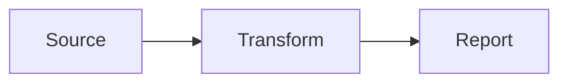

# Interactive Document Viewer

A modern, static documentation and report viewer built with **React**, **TypeScript**, and **Material UI (MUI)**, hosted on **GitHub Pages**.

The application is designed for **read-only document visualization** and supports a wide range of interactive report formats including diagrams, charts, dashboards, architecture documentation, release notes, and structured data viewers.

---

## 🎯 Purpose

This repository provides a lightweight and scalable platform for publishing and viewing technical documentation, architecture artifacts, release reports, and business dashboards as a static website.

**Key Characteristics**

- ✅ Read-only document viewer
- ✅ Static website hosted on GitHub Pages
- ✅ No backend required
- ✅ Responsive UI powered by Material UI (MUI)
- ✅ Supports interactive visualizations
- ✅ Optimized for large technical documentation repositories

---

## 🏗️ Technology Stack

### Frontend

- React
- TypeScript
- Material UI (MUI)
- React Router
- Markdown Renderer
- Mermaid
- SVG Pan Zoom
- Chart Libraries (Recharts / Chart.js / ECharts)

### Hosting

- GitHub Pages

### CI/CD

- GitHub Actions

---

## ✨ Supported Content Types

### 1. Mermaid Diagrams

Render architecture and workflow diagrams directly from Mermaid source.

Supported examples:

- Flowcharts
- Sequence Diagrams
- State Diagrams
- Class Diagrams
- ER Diagrams
- User Journeys
- Gantt Charts
- Git Graphs

Example:



---

### 2. Interactive Charts

Display data visualizations including:

- Line Charts
- Bar Charts
- Pie Charts
- Area Charts
- Scatter Charts
- Heatmaps
- Trend Analysis

Supported formats:

- JSON
- CSV

---

### 3. SVG Viewer with Zoom & Pan

Interactive SVG support with:

- Zoom In / Out
- Pan Navigation
- Fit to Screen
- Fullscreen Mode
- Mini-map Navigation

Ideal for:

- Architecture Diagrams
- Infrastructure Maps
- UML Diagrams
- Process Flows

---

### 4. Markdown Documents

Render Markdown files with support for:

- Tables
- Code Blocks
- TOC (Table of Contents)
- Internal Navigation
- Syntax Highlighting
- Mermaid Embedding

Supported format:

```text
.md
```

---

### 5. PDF Viewer

Embedded PDF support for:

- Design Documents
- Business Requirements
- Release Notes
- Technical Specifications
- Architecture Documents

Supported format:

```text
.pdf
```

---

### 6. JSON & CSV Viewer

Structured data inspection with:

- Tree View
- Expand / Collapse
- Search
- Syntax Highlighting
- Filtering
- Sorting

Supported formats:

```text
.json
.csv
```

---

### 7. Interactive Table Viewer

Features:

- Client-side Search
- Pagination
- Sorting
- Filtering
- Export Capability
- Sticky Headers

Ideal for:

- Release Data
- Product Catalogs
- Environment Comparison Reports
- Inventory Reports

---

### 8. Architecture Viewer

Purpose-built support for architecture documentation:

- Solution Architecture
- System Architecture
- Application Architecture
- Integration Architecture
- Cloud Architecture

Supported formats:

- Mermaid
- SVG
- PNG
- PDF
- Markdown

---

### 9. Release Note Dashboard

Interactive release note visualization including:

- Version History
- Release Timeline
- Deployment Summary
- Environment Comparison
- Change Tracking
- Release Verification Reports

Supported environments:

- DIT
- DIT2
- SIT
- UAT
- PS2
- PROD

---

## 📂 Supported File Types

| File Type | Supported |
|------------|------------|
| HTML | ✅ |
| Markdown (.md) | ✅ |
| PDF (.pdf) | ✅ |
| JSON (.json) | ✅ |
| CSV (.csv) | ✅ |
| SVG (.svg) | ✅ |
| PNG / JPG | ✅ |
| Mermaid (.mmd) | ✅ |

---

## 📁 Recommended Project Structure

```text
project-root/
│
├── public/
│   ├── documents/
│   ├── reports/
│   ├── diagrams/
│   ├── release-notes/
│   └── assets/
│
├── src/
│   ├── components/
│   ├── pages/
│   ├── viewers/
│   ├── layouts/
│   ├── hooks/
│   ├── services/
│   └── utils/
│
├── docs/
│
├── .github/
│   └── workflows/
│
└── README.md
```

---

## 🚀 Deployment

Build the application:

```bash
npm install
npm run build
```

Deploy to GitHub Pages:

```bash
npm run deploy
```

---

## 🔒 Design Principles

- Read-only content
- No document editing capabilities
- Static hosting only
- Fully client-side rendering
- Responsive design
- Accessibility friendly
- Dark / Light theme support

---

## 🎨 UI Features

- Material UI Design System
- Responsive Layout
- Dark Mode
- Light Mode
- Search Across Documents
- Navigation Sidebar
- Breadcrumb Navigation
- Fullscreen Viewer
- Mobile Friendly

---

## 📈 Typical Use Cases

- Technical Documentation Portal
- Architecture Repository
- Release Management Dashboard
- Deployment Verification Reports
- Product Documentation
- Engineering Knowledge Base
- Business Reporting Portal
- Interactive HTML Reports
- Mermaid-based Architecture Viewer

---

## License

MIT License
